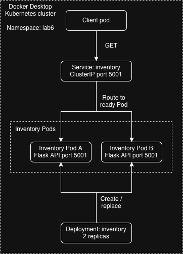

# CMPE 273 Lab 6 — Kubernetes Inventory



This lab runs two Inventory replicas and one client. The client sends requests
to `http://inventory:5001`, using the Kubernetes Service name. Each response
includes the serving Pod's name so you can observe traffic reaching both replicas.
The Inventory API follows the earlier labs' `GET /v1/items/sku-123` endpoint,
with an initial quantity of 7. This lab uses read-only stock in each replica.

## 1. Prerequisites

Install Docker Desktop and kubectl. Start Docker Desktop, enable Kubernetes in
its settings, and wait for the cluster to be running. Then select the context:

```bash
kubectl config use-context docker-desktop
kubectl get nodes
```

The node should show `Ready`. Run the remaining commands from the 
directory. No host Python environment is needed; both programs run in containers.

## 2. Build and deploy

```bash
docker build -t cmpe273-inventory:lab6 .
kubectl apply -f k8s/app.yaml
kubectl -n lab6 rollout status deployment/inventory --timeout=120s
kubectl -n lab6 wait --for=condition=Ready pod/client --timeout=120s
kubectl -n lab6 get pods -o wide
kubectl -n lab6 get service inventory
```

The manifest creates namespace `lab6`, an Inventory Deployment with two
replicas, a ClusterIP Service named `inventory`, and one client Pod. The Pod
listing should show two `inventory-...` Pods and one `client`, all `1/1 Running`.

Docker Desktop's cluster must be able to use the locally built image. If using
kind instead, run `kind load docker-image cmpe273-inventory:lab6` before applying
the manifest. For minikube, use `minikube image load cmpe273-inventory:lab6`.
For a remote cluster, push the image to a registry and update both `image`
references in `k8s/app.yaml`. If Pods show `ImagePullBackOff` or `ErrImagePull`,
check that the image is available to your cluster.

## 3. Observe client requests and both replicas

The client starts automatically and sends one request per second. Follow its logs:

```bash
kubectl -n lab6 logs -f client
```

Press Ctrl-C to stop following the logs; the client keeps running. Each successful
response includes the Service URL, `item_id`, `available`, and `pod`. The URL
stays `http://inventory:5001/v1/items/sku-123` even when the responding Pod changes.

Run a finite batch from the same client Pod and require responses from both replicas:

```bash
POD_A=$(kubectl -n lab6 get pods -l app=inventory -o jsonpath='{.items[0].metadata.name}')
POD_B=$(kubectl -n lab6 get pods -l app=inventory -o jsonpath='{.items[1].metadata.name}')
kubectl -n lab6 exec client -- python client.py --count 60 --interval 0.1 --expect "$POD_A" "$POD_B"
```


The final `summary` counts responses per Pod. The command fails if either Pod
is missing or a request fails. Each request opens a new connection so Service
routing can select a backend again. Distribution is probabilistic and need not
alternate evenly; rerun if a sample happens to miss a replica.

The Service's short DNS name works because the client is in the same namespace.
With the default cluster domain, its full name is
`inventory.lab6.svc.cluster.local`. No client request uses a Pod IP.

## 4. Make one Pod fail readiness

Use the `POD_A` and `POD_B` variables from the preceding step in the same shell.
Create a marker file inside just the first Pod:

```bash
kubectl -n lab6 exec "$POD_A" -- python -c "from pathlib import Path; Path('/tmp/inventory-not-ready').touch()"
kubectl -n lab6 wait --for=condition=Ready=false "pod/$POD_A" --timeout=60s
kubectl -n lab6 get pods
kubectl -n lab6 get endpointslices -l kubernetes.io/service-name=inventory -o yaml
```


The selected Pod should show `0/1 Running`, while the other remains `1/1 Running`.
The unready Pod's EndpointSlice entry has `conditions.ready: false`, excluding
it from normal Service traffic. The readiness probe calls `/ready`, which
returns 503 while the file exists. The independent liveness endpoint `/health`
continues returning 200, so readiness failure does not restart the container.

Allow a few seconds for Service routing rules to converge, then verify that
only the ready Pod receives this batch:

```bash
sleep 5
kubectl -n lab6 exec client -- python client.py --count 60 --interval 0.1 --expect "$POD_B" --exclude "$POD_A"
```


The summary should contain only `POD_B`, with zero errors. The command fails if
the unready Pod responds. This follows Kubernetes'
[documented readiness behavior](https://kubernetes.io/docs/concepts/workloads/pods/probes/).

## 5. Restore readiness

```bash
kubectl -n lab6 exec "$POD_A" -- python -c "from pathlib import Path; Path('/tmp/inventory-not-ready').unlink(missing_ok=True)"
kubectl -n lab6 wait --for=condition=Ready "pod/$POD_A" --timeout=60s
kubectl -n lab6 get pods
sleep 5
kubectl -n lab6 exec client -- python client.py --count 60 --interval 0.1 --expect "$POD_A" "$POD_B"
```


Both Pods should be `1/1 Running`, and both names should appear in the summary
again. The restored Pod keeps its original name.

## 6. Delete a Pod and observe recovery

In a second terminal, keep the existing client's request stream visible:

```bash
kubectl -n lab6 logs -f client
```

In the original terminal, record the Service identity and delete one Pod:

```bash
SERVICE_BEFORE=$(kubectl -n lab6 get service inventory -o jsonpath='{.metadata.name} {.metadata.uid} {.spec.clusterIP}')
echo "$SERVICE_BEFORE"
echo "Deleting $POD_A"
kubectl -n lab6 delete pod "$POD_A" --wait=false
kubectl -n lab6 get pods -w
```


The Deployment creates a replacement with a different name. Once there are two
`1/1 Running` Inventory Pods again, press Ctrl-C to stop the watch, then verify:

```bash
kubectl -n lab6 rollout status deployment/inventory --timeout=120s
kubectl -n lab6 get pods -o wide
SERVICE_AFTER=$(kubectl -n lab6 get service inventory -o jsonpath='{.metadata.name} {.metadata.uid} {.spec.clusterIP}')
echo "$SERVICE_AFTER"
test "$SERVICE_BEFORE" = "$SERVICE_AFTER" && echo "PASS: Service name, UID, and ClusterIP unchanged"
NEW_A=$(kubectl -n lab6 get pods -l app=inventory -o jsonpath='{.items[0].metadata.name}')
NEW_B=$(kubectl -n lab6 get pods -l app=inventory -o jsonpath='{.items[1].metadata.name}')
sleep 5
kubectl -n lab6 exec client -- python client.py --count 60 --interval 0.1 --expect "$NEW_A" "$NEW_B" --exclude "$POD_A"
```


Compare the new names with the deleted `POD_A`: the survivor remains and the
replacement has a new suffix. Client logs continue using the same Service URL,
and the final batch must reach both current replicas. A request already in
flight during deletion can fail; the continuous client logs the error and
continues sending subsequent requests through the Service.

## 7. Cleanup

```bash
kubectl delete namespace lab6
```

This removes the client, Deployment, Pods, and Service for this lab.

## Reflection

A stable Service name is useful when Pods can fail or be replaced because the client can use the same address
pointing to the same group of Pods, though some Pods may have failed or been replaced. When a Pod is replaced, 
Kubernetes automatically updates the Service's endpoints so that traffic can be directed to Pods passing readiness
check. Therefore the client does not need to care when the backend configuration is changed.